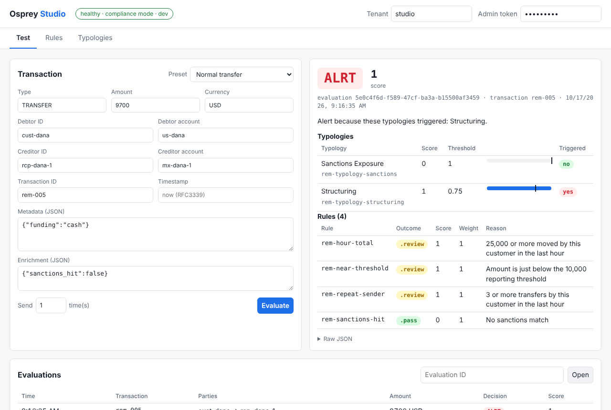

# Osprey Studio

Osprey Studio is a web page that Osprey serves at `/studio/`.
Use it to write rules and typologies, send test transactions, and read each decision.
Studio is part of the Osprey binary. It needs no install and no build step.



## Open Studio

1. Start Osprey:

```bash
export OSPREY_ADMIN_TOKEN=local-admin-token
go run ./cmd/osprey
```

2. Open `http://localhost:8080/studio/` in a browser.
3. Enter a tenant ID at the top of the page. The default is `studio`.
4. Enter the admin token to save rules and typologies.

Studio does not need the admin token to send test transactions or to read rules.
Studio keeps the token in the session storage of the browser tab only.
When you close the tab, the browser deletes the token.

**WARNING:** Do not open Studio on a shared computer with a production admin token. The token gives write access to all rules and typologies.

## Pages

| Page | What you can do |
|------|-----------------|
| Test | Send a transaction from a preset or from your own values. Read the decision, the score, the reason for the decision, and the result of each rule and typology. Open a stored evaluation by its ID. |
| Rules | Write a CEL expression. Studio compiles the expression as you type and shows the error. Set the weight and the bands, then save. Import and export rules as JSON. |
| Typologies | Group rules with weights and set the alert threshold. Import and export typologies as JSON. |

The Rules page lists the CEL variables from `GET /rules/variables`.
Click a variable to put it into the expression.

## How Studio Works

Studio is static HTML, CSS, and JavaScript.
It uses the public HTTP API, the same API as any other client.
It has no special access and no separate backend.

| Action | API call |
|--------|----------|
| Send a transaction | `POST /evaluate`, then `GET /evaluations/{id}` for the rule results |
| Check an expression | `POST /rules/validate` |
| Save a rule | `POST /rules` or `PUT /rules/{id}` |
| Save a typology | `POST /typologies` or `PUT /typologies/{id}` |

## Limits

- Rules and typologies are global. A change in Studio applies to all tenants on the server.
- The Osprey API lists only enabled rules and typologies. If you disable an item in Studio, Studio keeps a copy in the local storage of the browser. Use this copy to enable the item again.
- The evaluation list shows only the transactions that this browser tab sent. Osprey has no API to list all evaluations.
- Velocity rules count each test transaction. Use new party IDs for each test, or start Osprey with a new database.
- Typologies have an effect only in compliance mode. In detection mode, Studio shows a notice on the Typologies page.

## Turn Studio Off

Studio is on by default.
To turn it off, set `OSPREY_STUDIO=false`.
Then Osprey does not serve `/studio/`.
The API endpoints that Studio uses stay available.
